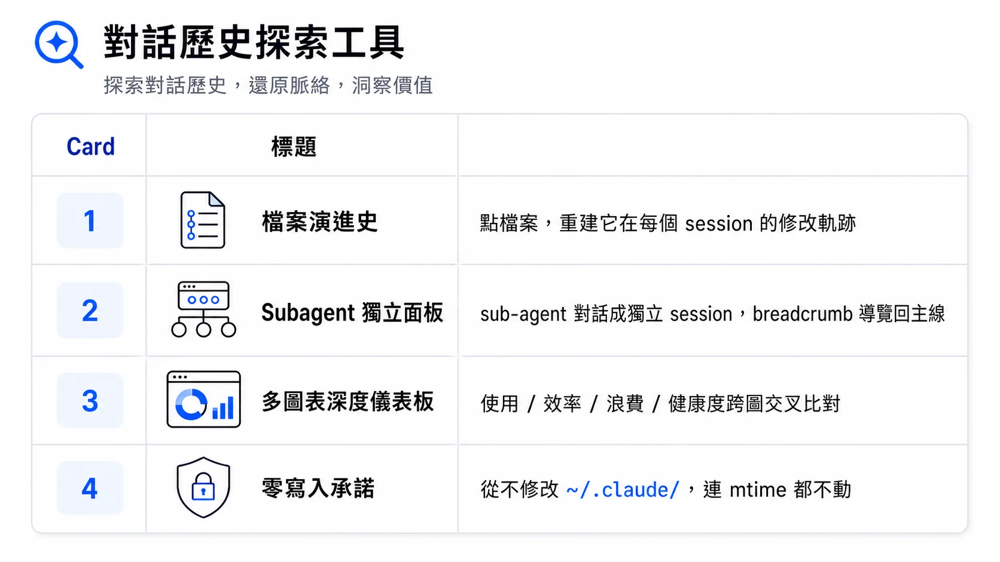
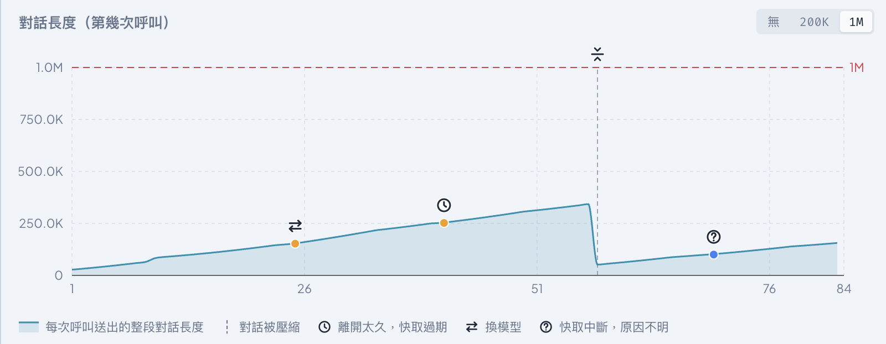
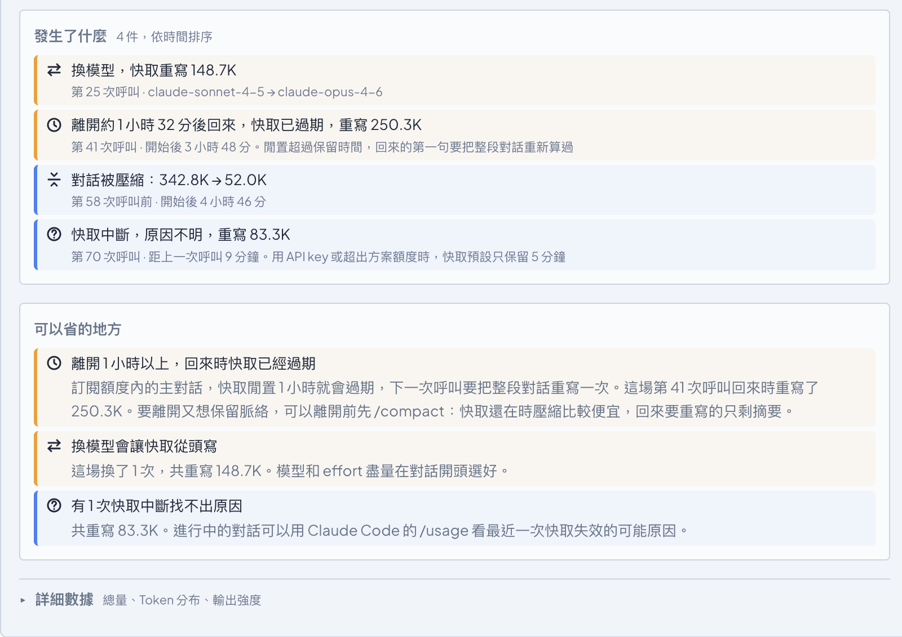
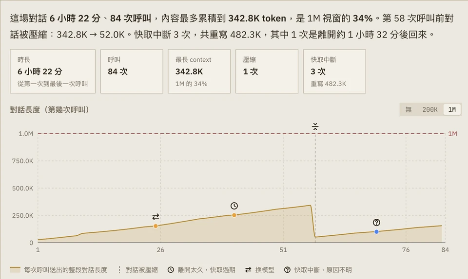
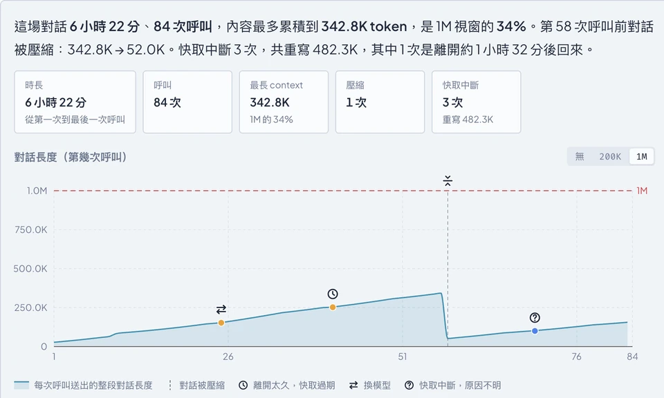
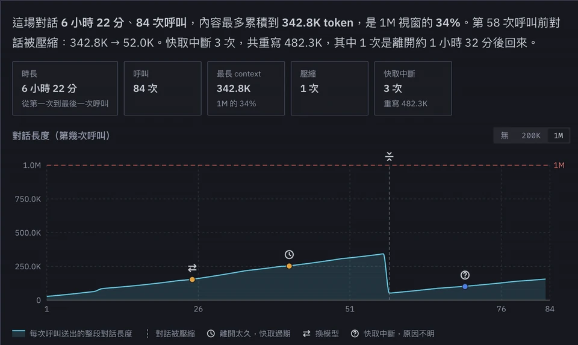
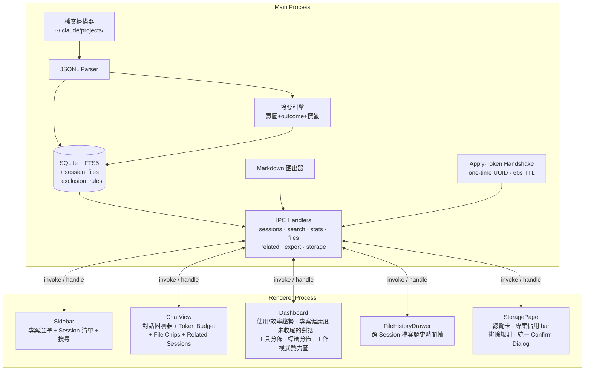

# ccRewind

[](https://www.gnu.org/licenses/gpl-3.0)
[](https://www.typescriptlang.org/)
[](https://reactjs.org/)
[](https://www.electronjs.org/)

[English](README_EN.md)

追溯你跟 Claude Code 的決策軌跡。輕量、唯讀、離線優先，你的 `~/.claude/` 一個位元組都不會動。

<p align="center">
  
</p>

<p align="center">
  
  
</p>

### 從結果回推決策路徑

對話裡藏著「這個決定當初是怎麼來的」，但 JSONL 檔案本身不會告訴你。ccRewind 把它挖出來：

- **檔案歷史** — 點一個檔案，看它在哪些主 session 被動過、是讀取還是修改
- **相關 Session** — 用共用檔案的 Jaccard 相似度，找出動過同一批檔案的其他對話
- **Tasks Panel** — AI 在這段對話規劃了哪些步驟、各自的狀態與宣告的 blockedBy 相依
- **Subagent 對話** — subagent 的完整逐字紀錄可以點進去讀，不是主對話裡的一行摘要

Claude Code 預設 30 天清掉 session JSONL。過了那條線，索引庫裡的副本就是那段對話還留著的地方。

---

## 核心概念

ccRewind 讀取 `~/.claude/projects/` 下的 JSONL 對話紀錄，建立 SQLite + FTS5 索引，提供瀏覽、搜尋、匯出功能。

Session 摘要由結構化規則引擎產生（意圖提取 + 動作概要 + outcome 推斷），零 API 成本。標籤透過文字、路徑、工具模式三軌交叉推斷。ccRewind 屬 ccFamily 三件套，整體哲學是 rule-based + zero API cost，**不規劃引入 LLM 路線**；更深入的「跨 session ADR 推理」由規劃中的姊妹 plugin **ccReason** 承接（讀 ccRecall schema，獨立 npm 包）。

所有操作都是唯讀的。ccRewind 絕不修改 `~/.claude/` 下的任何檔案，你的對話紀錄、記憶檔案、設定檔，一個位元組都不會動。

Claude Code 刪除 Session 後，ccRewind 會自動封存該筆對話。所有訊息、標籤、摘要都留在 SQLite 裡，不會隨 JSONL 檔案消失。

---

## 為什麼用 ccRewind

不追功能廣度，專注把幾件事做深。

<p align="center">
  
</p>

---

## 功能特色

<details open>
<summary><b>統計與考古</b></summary>

| 功能 | 說明 |
|------|------|
| **統計儀表板** | 跨 session 分析：使用趨勢（雙軸面積圖）、效率趨勢（每則 JSONL 記錄的平均 token）、未收尾的對話（沒有 commit/test 結果的 session 依 token 用量由高到低排序，一鍵跳轉）、專案健康度（outcome 堆疊條 + 趨勢箭頭）、工具/標籤分佈、工作模式熱力圖 |
| **跨 Session 考古** | 檔案歷史抽屜（點檔案看它在哪些 session 出現過）、相關 Session 推薦（Jaccard 相似度）、可展開 File Chips |
| **檔案反向索引** | 每個 session 操作了哪些檔案、什麼操作（Read·Edit·Write 記為 read/edit/write，Glob·Grep 記為 discovery），可點擊檔案追蹤跨 session 歷史。同時整合 attachment 層的檔案編輯紀錄，涵蓋 tool call 以外的檔案變更；Bash 指令內的檔案操作不在索引範圍 |
| **Attribution 歸因追蹤** | 記錄每條 AI 回覆使用了哪個 Skill、Plugin、MCP Server/Tool 或 Agent——追溯「這段回答是怎麼產出的」，從結果回推決策路徑 |
| **Session 自動摘要** | 結構化摘要引擎：意圖提取（跳過 greeting）、動作概要（Edit×8, 5 files）、outcome 推斷（committed/tested/in-progress）、20+ 條多信號標籤 |
| **Subagent 瀏覽** | 自動掃描 `subagents/*.jsonl` 並建立索引。有 subagent 的 Session 顯示可點擊 chips（agent type + 訊息數；JSONL 未記錄 agent type 時顯示通用標籤），點擊進入後以 breadcrumb 導覽回 parent session |
| **Tasks Panel** | 自動掃描 `~/.claude/tasks/{sessionId}/*.json` 並在 ChatView 顯示任務快照——subject、三態 status 徽章、blockedBy chips，讓你看清楚 AI 在這段對話裡規劃了哪些步驟、哪幾條卡住。`(session_id, task_id)` PK 獨立於 session reindex，刪掉 session 重建時不會把任務資料一起洗掉；同一 task 以最新狀態覆寫，不保留狀態變化過程 |

</details>

<details open>
<summary><b>對話瀏覽與搜尋</b></summary>

| 功能 | 說明 |
|------|------|
| **對話瀏覽** | user/assistant 氣泡介面，Markdown 渲染 + 程式碼語法高亮 |
| **思考過程摺疊** | Assistant 的 thinking（推理過程）以可摺疊區塊呈現，預設收合、lazy mount，大型推理內容不影響效能 |
| **Rewind 棄用分支標記** | 偵測同一 session 內因 rewind 產生的分岔，把已被取代的分支標記為虛線邊框 + 徽章，避免誤讀成一則沒人回覆的孤立訊息 |
| **Tool 摺疊** | tool_use / tool_result 預設摺疊，點擊展開查看完整內容 |
| **Markdown 匯出** | 一鍵將 Session 匯出為 `.md` 檔案，含 Metadata 表格 + Tool 摺疊 |
| **全文搜尋** | FTS5 索引，分頁載入，結果按 Session 分組，支援「對話」與「標籤/檔案」兩種搜尋模式，可依日期範圍過濾（7天/30天/90天）、切換相關性或時間排序 |
| **搜尋上下文預覽** | 搜尋結果可展開顯示前後 2 則訊息，不用跳轉就能快速判斷相關性。結果顯示 Session 日期與 outcome 狀態 badge |
| **Session 星號標記** | Hover 顯示 ☆ 按鈕，點擊切換 ★ 標記，搭配 ★ filter 只看加星的 session。獨立 `session_stars` 表不受 reindex 影響，optimistic update 即時回饋 |

</details>

<details>
<summary><b>Token 與 Context</b></summary>

| 功能 | 說明 |
|------|------|
| **Token Budget 視覺化** | 對話長度圖（橫軸是第幾次呼叫，標出壓縮與快取中斷）、Token 分布圓餅、輸出強度熱力條；說明與截圖見下方的 [Token Budget 面板](#token-budget-面板) |
| **白話摘要** | 一句話講完這場對話（多長、呼叫幾次、內容最多累積到多少），依時間列出對話壓縮與快取中斷（閒置過期、換模型、原因不明），只在真的發生過時才給省 token 的建議，讓圖表不只好看還能看懂 |
| **Token 熱力指示** | Assistant 訊息左側色碼條（綠=cache 命中佳、紅=高成本），Session 列表顯示 token 總量並可依 token 排序 |
| **精確 Token 統計** | 自動偵測同一 API response 被拆成多個 JSONL entries 的情況，透過 requestId 去重避免 token 重複計算（修正 ~2.3x 膨脹） |

</details>

<details>
<summary><b>資料與儲存</b></summary>

| 功能 | 說明 |
|------|------|
| **資料保全** | JSONL 被刪除時自動封存對話：文字、工具呼叫與結果、思考過程都會留在索引裡；圖片與 PDF 區塊的 base64 資料、思考簽章則以標記取代 |
| **儲存管理** | 檢視索引資料庫佔用（DB 大小、Session/Message 數、專案佔比視覺化 bar），以排除規則管理索引範圍——一鍵排除整個專案或依日期範圍排除，可選擇保留既有資料、只停止之後的索引，或連既有資料一起刪除以釋放空間；刪除走雙重確認（checkbox + >50% 紅色警告 banner），IPC 層 apply-token handshake 防 renderer 繞過 |
| **DB 壓縮** | Storage 頁顯示可回收空間（freelist × page_size，PRAGMA 即時讀取），一鍵 VACUUM 釋放 SQLite DELETE 留下的 free pages，確認對話框明確標示僅重組檔案結構不刪資料 |
| **圖片與簽章瘦身** | 偵測訊息中直接附帶的圖片（例如貼上的截圖）並標記該則訊息。圖片與 PDF 區塊的 base64 資料（含工具結果裡的截圖）app 不會顯示成圖片或 PDF，thinking 的加密簽章也不顯示，所以儲存時把這些資料換成標記、其餘欄位保留，減少它們佔用的空間；v1.24.0 升級時既有資料也一併處理 |
| **增量索引** | 首次啟動掃描所有 JSONL，後續僅處理新增/修改的檔案。Resumed session 自動 UUID 去重，不產生重複訊息 |
| **DB 自動遷移** | schema 變更時自動升級；需要改寫既有資料的升級會拉長第一次開啟的時間，依資料量與電腦而異（v1.24.0 在維護者 1.9 GB 的索引上處理約 8 秒） |

</details>

<details>
<summary><b>介面與互動</b></summary>

| 功能 | 說明 |
|------|------|
| **三主題切換** | 檔案室（Archive）、時間線（Timeline）、終端回憶（Terminal），一鍵切換 |
| **Active Time** | Session 時長優先顯示活動時間（排除 >5 分鐘閒置），括號附註掛鐘時間。儀表板平均時長同步使用 active time |
| **更新通知** | 啟動時自動偵測 GitHub 新版本，一鍵開啟下載頁面 |
| **虛擬捲動** | 大量 Session 不卡頓（@tanstack/react-virtual） |
| **多語介面** | 繁體中文與英文 UI 切換，所有文字走 type-safe MessageKey 目錄（zh-TW 預設），localStorage 持久化 |
| **字級縮放** | 三檔字級切換（一般 1.0× / 大 1.1× / 特大 1.25×），透過 `--font-scale` CSS 變數驅動，boot-time 載入避免 FOUC |
| **Sync 狀態提示** | 視窗 focus 自動重新索引（in-flight Promise 合併防 thrashing）+「立即同步」按鈕 +「上次索引 Xs 前」狀態標籤 |
| **Sidebar 鍵盤導覽** | 專案、Session、訊息搜尋、Session 搜尋四個列表皆支援 ↑↓ 導覽，搜尋框 ↓ 鍵交棒給結果第一筆；虛擬化列表使用 aria-activedescendant 模式，捲動時不丟焦點 |
| **無障礙** | WCAG 2.1 AA 對比度、ARIA 標籤（含 radio 鍵盤模式）、焦點管理 |

</details>

### Token Budget 面板

在對話檢視按「顯示 Token Budget」，面板由上往下讀這場對話發生了什麼。下面三張截圖用的是合成的示範資料（見本節最後）。

<p align="center">
  
</p>

**一句話與五張數字卡**

- 一句話講完這場對話：多長、幾次呼叫、內容最多累積到多少 token、有沒有被壓縮、快取有沒有中斷、中斷時重寫了多少。「呼叫」是送給模型的一次請求，一次提問帶出的每一輪工具往返都各算一次
- **時長**是第一次到最後一次呼叫，中間離開的時間也算在內；側欄優先顯示的則是扣掉閒置的活動時間
- **最長 context** 只在有證據時換算成 1M 視窗的百分比：有某次呼叫超過 200K 才算 1M。沒有證據、最長又到 160K 以上時，會說看不出視窗是 200K 還是 1M，不從模型名稱猜
- 完全沒有讀寫過快取的 session（例如不支援 prompt caching 的供應商），快取中斷卡顯示「—」，句子會說沒有用到 prompt 快取，而不是「快取沒有中斷」

<p align="center">
  
</p>

**對話長度圖**

- 面積是每次呼叫送出的整段對話長度，橫軸是第幾次呼叫
- 虛線標出發生在兩次呼叫之間的壓縮（同一段空檔裡有好幾則摘要也只畫一條）；壓縮 5 次以內會在線上加圖示，超過 20 次改成淡色實線
- 圓點是**重寫量最大的 5 次快取中斷**，圖示表示原因：時鐘是離開太久、快取過期，互換箭頭是換模型，問號是原因不明。其餘的中斷在下方清單
- **快取中斷**的判斷：某次呼叫從快取讀到的不到上一次 prompt 的一半，prompt 卻沒有縮小（仍有上一次的八成以上）；前提是上一次有用到快取、這次有寫入快取，而且不是壓縮後的第一次呼叫。前後兩次的模型都已知而且不同，算換模型；不是換模型、距上一次呼叫又有 60 分鐘以上，算離開太久；其餘是原因不明。**重寫量**只算上一次的 prompt 這次沒讀到的部分，回來後新貼上的內容不算
- 上限線可以切換「無／200K／1M」：有 1M 證據時預設畫 1M，否則不畫；切換只改參考線，不會改句子與數字卡
- 滑鼠停在某次呼叫上，會列出那次的所有事件，包括沒畫成圓點的

<p align="center">
  
</p>

**發生了什麼、可以省的地方**

- 「發生了什麼」依時間列出每次壓縮與快取中斷，超過 6 件時先分類彙總，可以展開完整清單。最後一次呼叫之後才發生的壓縮也算進次數，排在最後，標明量不到前後
- 「可以省的地方」只列這場真的發生過的情況，各附本場的數字：離開 1 小時以上（離開前先 `/compact`，回來要重寫的只剩摘要）、換模型（模型與 effort 盡量在開頭選好）、找不出原因的中斷（進行中的對話可以用 Claude Code 的 `/usage` 看最近一次快取失效最可能的原因，找得出來時才會列）
- 「詳細數據」預設收合：總量、Token 分布圓餅、輸出強度熱力條

**已知限制**

- 呼叫數比圖表的像素寬度還多的長 session，滑鼠只停得到其中一部分呼叫，指著標記時可能跳出隔壁那次；所有事件仍列在清單裡
- 「有呼叫超過 200K 就是 1M 視窗」假設視窗只有 200K 與 1M 兩種，程式不看是哪個模型
- 快取能留多久要看計費方式：訂閱方案額度內的主對話是 1 小時，用 API key 或超出方案額度時預設 5 分鐘。離開太久的 60 分鐘門檻，是用一位使用者（訂閱方案）的資料校準的

> **關於截圖**：這幾張圖是在 app 裡實際開出來的，資料則是合成的：專案、對話內容與 token 數字都是虛構的，刻意讓一場對話同時出現壓縮、三種快取中斷與超過 200K 的 context，不是任何人的真實使用紀錄。資料由 [`scripts/readme-fixture.mjs`](scripts/readme-fixture.mjs) 產生，同一份資料可以重現這些截圖。

### 三種佈景主題

一鍵切換三種視覺風格。下面是同一場示範對話的 Token Budget 面板（一句話、數字卡與對話長度圖）在三種主題下的樣子。

<table>
  <tr>
    <td align="center"><strong>📂 檔案室 Archive</strong></td>
    <td align="center"><strong>🕐 時間線 Timeline</strong></td>
    <td align="center"><strong>💻 終端回憶 Terminal</strong></td>
  </tr>
  <tr>
    <td></td>
    <td></td>
    <td></td>
  </tr>
</table>

---

## 使用說明

- 第一次使用 → **[docs/GETTING-STARTED.md](docs/GETTING-STARTED.md)**（5 分鐘上手：安裝、索引、第一次瀏覽與搜尋）
- 各功能詳細使用方式 → **[docs/USER-GUIDE.md](docs/USER-GUIDE.md)**（Session 摘要與標籤、搜尋、Context Budget、統計儀表板、跨 Session 考古、儲存管理）

---

## 系統架構



---

## 技術棧

| 技術 | 用途 | 備註 |
|------|------|------|
| Electron 44 | 桌面應用框架 | macOS hiddenInset title bar |
| React 19 | UI 框架 | 函式元件 + hooks |
| TypeScript 5.9 | 型別安全 | strict mode |
| better-sqlite3 13 | SQLite binding | 含 FTS5 全文搜尋 |
| recharts 3 | 圖表庫 | 面積圖、圓餅圖、甜甜圈圖（Context Budget + Dashboard） |
| electron-vite 5 | 建構工具 | main + preload + renderer 三路建構 |
| Vitest 3 | 測試框架 | 545 個測試，透過 Electron 執行 |

---

## 下載安裝

從 [Releases](https://github.com/tznthou/ccRewind/releases) 頁下載對應平台的預編譯版：

- **macOS**（arm64）：DMG 拖曳到 Applications，或 ZIP 解壓後直接執行
- **Windows**（x64）：NSIS installer 或 ZIP

系統需求：macOS 13+ / Windows 10+

### 首次啟動警告

ccRewind 尚未取得 Apple Developer ID / Microsoft 程式碼簽章，首次執行時作業系統會顯示未簽章應用的警告，這是正常行為：

- **macOS**：出現「無法驗證開發者」時，開啟「系統設定 → 隱私與安全性」，找到 ccRewind 並點擊「仍要打開」
- **Windows**：SmartScreen 顯示「Windows 已保護您的電腦」時，點擊「其他資訊」→「仍要執行」

---

## 快速開始

### 環境需求

- Node.js >= 20, < 23
- pnpm >= 9

### 安裝與啟動

```bash
git clone https://github.com/tznthou/ccRewind.git
cd ccRewind
pnpm install
pnpm dev
```

### 建構發布

```bash
pnpm build
pnpm dist
```

### 其他指令

```bash
pnpm test        # 執行測試（透過 Electron 跑 Vitest）
pnpm typecheck   # TypeScript 型別檢查
pnpm lint        # ESLint 修正
```

---

## 專案結構

<details>
<summary>展開查看完整目錄樹</summary>

```
ccRewind/
├── src/
│   ├── main/                  # Electron main process
│   │   ├── index.ts           # 應用程式入口
│   │   ├── scanner.ts         # 專案 / Session 檔案掃描
│   │   ├── parser.ts          # JSONL 解析器
│   │   ├── database.ts        # SQLite + FTS5 管理（含 sessions_fts + session_files + 統計查詢 + Jaccard）
│   │   ├── indexer.ts         # 增量索引器
│   │   ├── summarizer.ts      # 結構化摘要引擎（意圖提取 + outcome 推斷 + 多信號標籤 + session_files）
│   │   ├── task-parser.ts     # Tasks JSON 解析器（~/.claude/tasks/）
│   │   ├── exporter.ts        # Markdown 匯出
│   │   ├── updater.ts         # GitHub Release 更新偵測
│   │   ├── logSafe.ts         # 記錄檔逃逸（檔名可含換行與終端控制序列）
│   │   └── ipc-handlers.ts    # IPC 通訊處理
│   ├── preload/               # contextBridge 安全橋接
│   │   └── index.ts
│   ├── renderer/              # React 前端
│   │   ├── App.tsx            # 根元件
│   │   ├── components/
│   │   │   ├── Sidebar/       # 專案選擇 + Session 清單 + 搜尋
│   │   │   ├── ChatView/      # 對話閱讀器 + Token 熱力指示 + File Chips + Subagent 導覽 + Tasks Panel + 匯出
│   │   │   ├── Dashboard/     # 統計儀表板：使用/效率趨勢、專案健康度、未收尾的對話、工具/標籤分佈、工作模式
│   │   │   ├── Archaeology/   # 跨 Session 考古：FileHistoryDrawer、RelatedSessionsPanel
│   │   │   ├── Storage/       # 儲存管理：總覽卡、專案佔用 bar、排除規則、統一 Confirm Dialog
│   │   │   ├── TokenBudget/   # Context Budget 面板：白話摘要、對話長度圖、事件與建議、圓餅圖、熱力條
│   │   │   ├── ThemeSwitcher/ # 三主題切換按鈕
│   │   │   ├── FontScaleSwitcher/ # 三檔字級縮放（含 ARIA radio 鍵盤模式）
│   │   │   ├── LiveRegion/    # 全域 aria-live 通知（搜尋結果、sync 狀態）
│   │   │   ├── ErrorBoundary/ # 兩層錯誤邊界：應用程式外殼 + 每則訊息
│   │   │   └── UpdateBanner/  # 更新通知橫幅
│   │   ├── hooks/             # useSession, useSessions, useProjects, useIndexerStatus, useListboxKeyNav（狀態機純函式在 listboxKeyNav.ts）
│   │   ├── i18n/              # LanguageSwitcher + 訊息目錄 + useI18n（zh-TW + en）
│   │   ├── utils/             # formatTokens, formatTime, formatDuration, pathDisplay, renderSnippet
│   │   └── context/           # AppContext + ThemeContext + FontScaleContext（語言／主題／字級皆 localStorage 持久化）
│   └── shared/
│       └── types.ts           # 主程序與渲染程序共用型別
├── tests/                     # Vitest 測試（641 個）
├── docs/                      # PRD / SPEC / PLAN
├── electron-builder.yml
└── package.json
```

</details>

---

## 隨想

### 為什麼做這個

跟 Claude Code 協作的對話散落在 `~/.claude/projects/` 底下，每個 Session 是一個 JSONL 檔案。想回頭看三天前的設計決策？你得記得是哪個 Session、手動 `cat` JSONL、在密密麻麻的 JSON 裡面找到那段對話。

現有的方案要嘛太重（RAG、向量搜尋），要嘛方向不對（記憶注入、Context 管理）。我只是想安靜地回顧過去的對話，像翻一本考古筆記。

所以我做了 ccRewind。一開始，它是一本有索引的考古筆記本。

### 然後呢

「不追廣度，挖深」是初衷，但「深」是什麼？在 AI 社群聚會跟人聊過之後，慢慢有了答案：不是把功能列得更長，而是把同一份 JSONL 看到更多層。看見什麼被改了、看見規劃在哪卡住、看見對話跑得順不順、看見 Subagent 分身。

然後考古不夠用了。

本來只是翻舊對話看看當初怎麼想的，遇到 bug 會複製一整段對話貼過去當 context。後來發現直接複製 session ID 就夠了。一貼就能跳回當時的對話，比整段複製更快更準。

考古裡長出了追溯。你以為自己在翻歷史，其實你在追一條線：這個 bug 是哪段對話埋的？那個設計轉彎是在哪裡決定的？沒人規劃過這件事。是用出來的。

然後那條線斷了。Session JSONL 預設 30 天就清掉，`--resume` 失效，session ID 指向的對話不見了。但 ccRewind 的 SQLite 還在——用 Python 內建的 `sqlite3` 查 `~/.ccrewind/index.db`，摘要、標籤、檔案歷史都撈得回來，貼進新的 session 就接上了。追溯又活了。這也不是規劃出來的。

至於什麼內容值得留下來、我們又該怎麼把它收起來，這條線繼續走下去，長出了 ccRecall，成為 ccFamily 的一環。那又是另外一個故事了。

### Non-goals

ccRewind 刻意不做這些事：

- **不做 Context Injection**：不干預未來的對話，只回顧過去的
- **不做雲端同步**：所有資料來自本地 `~/.claude/`，不上傳任何東西
- **不修改任何檔案**：純唯讀應用，連 `~/.claude/` 的 mtime 都不會動。唯讀不等於什麼都可以讀——索引的範圍就是 `projects/` 底下的對話紀錄與對應的 tasks，同一層的設定檔不在裡面
- **不做即時監控**：不是 tail -f，是考古學
- **不引入 LLM 路線**：ccFamily 三件套堅持 rule-based + zero API cost；需要 ADR 推理層的場景由規劃中的 ccReason plugin 承接

如果你需要的是「讓 Claude 記住之前說過什麼」，去看 claude-mem 之類的記憶系統。ccRewind 解決的是不同的問題：讓人類回顧與 AI 的協作歷史。

### Roadmap

詳見 [docs/ROADMAP.md](docs/ROADMAP.md)。

---

## 授權

本專案採用 [GPL-3.0-or-later](LICENSE) 授權。

---

## 作者

子超 (tznthou) / [tznthou.com](https://tznthou.com)
